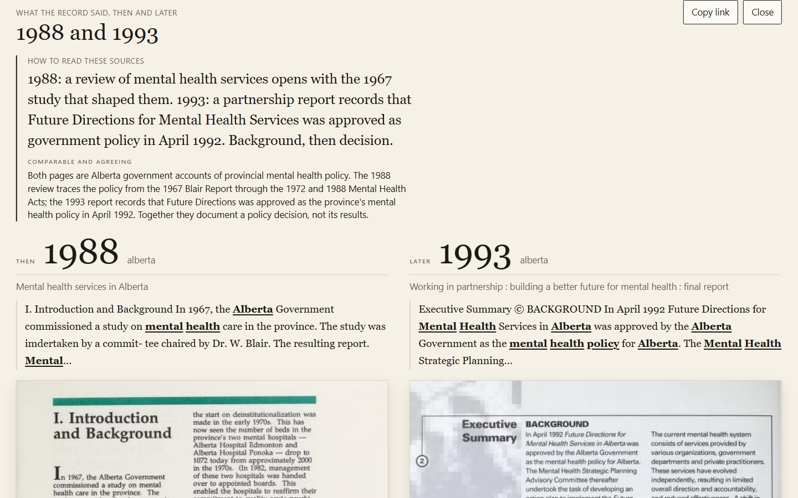

# Archive Argues With Itself

[](https://github.com/agentjakey/archive-argues-with-itself/actions/workflows/ci.yml)
[](LICENSE)

Ask Canada's public record a question in plain words. The site searches Internet Archive Canada's
scanned government publications, writes a short answer, and ties every sentence to the page it came
from, so you can open the scan and check. When the record cannot answer, it says so and shows you the
gap instead of guessing. Official wording changes from one decade's report to the next, and that
change is often the point: the site lets you put two pages, years apart, side by side.



## Use it

| | |
| --- | --- |
| [Ask](https://archiveargues.org) | Ask a question; every sentence links to its scanned page. |
| [Explore](https://archiveargues.org/?view=explore) | Browse by decade, by province, by collection, or the [full catalogue](https://archiveargues.org/catalogue/). |
| [Exhibit](https://archiveargues.org/exhibit/) | Short games built from real pages: date a page, decide whether two records are the same thing. |
| [Kiosk](https://archiveargues.org/kiosk) | The exhibit for a screen in a library or classroom: resets after a quiet minute, stores nothing. |

## How it works

1. Every catalogue record of the collection is listed; the scanned text of each document is fetched and indexed in parts.
2. A question searches the parts that hold its words, by keyword search (BM25).
3. A writer model (GLM-5.3, open-weight, on Cloudflare Workers AI) drafts sentences from those pages only.
4. Each sentence must cite a page that was retrieved; sentences that fail the checks are dropped.
5. The answer says how well its pages support it (one of six states), or refuses when the record is thin.

The site is a static release on Cloudflare, so the examples and stories work even while the engine sleeps.

## What it can and cannot do

- Every cited passage resolves to a recorded page (100% in every audit). Sentences fully supported by
  their cited page: 93.3% and 98.0% in the hand audits of the first two collections; 90.7% to 95.4% in
  the AI-checked audits of the newer parts.
- Against the previous pipeline, on 839 fresh test questions, the current one put the right page in the
  first ten 12.9 points more often and wrongly refused answerable questions 9.1 points less often.
- It still refuses many answerable questions (38% on that test), most often because search did not bring
  back enough. A refusal means "not found in what is indexed", never "not in the archive".
- The newer checks were made by AI judges and AI adjudication, not by people. Nothing is called
  AI-audited until outside human review exists.
- Scanned government text thins out after 2009 and stops in the 2010s. There is no 2020s material.

Every number, how it was measured, and what it does not say: [docs/ACCURACY.md](docs/ACCURACY.md).

## Coverage

As of 2026-11-03: answers can draw on 21,988 documents with searchable text, out of 118,044 in the
catalogue. The full-text fetch was 23% done and is expected to finish between 2026-11-06 and 2026-11-08;
parts are added as they are built and checked. Live figures: the [catalogue](https://archiveargues.org/catalogue/)
and the line under the question box.

## Run it yourself

```powershell
git clone https://github.com/agentjakey/archive-argues-with-itself
cd archive-argues-with-itself
python -m venv .venv
.\.venv\Scripts\python.exe -m pip install -e ".[dev]"
.\.venv\Scripts\python.exe -m pytest          # no network, no model, no data needed
cd web; npm ci; npm test; cd ..
```

To serve answers you need the data. The quickest path is the federal pilot from the
[data release](https://github.com/agentjakey/archive-argues-with-itself/releases/tag/data-v1). Running
your own copy, on Cloudflare or on any Docker host: [docs/SELF_HOSTING.md](docs/SELF_HOSTING.md). All
documentation, by reader: [docs/README.md](docs/README.md).

## Credits

Built during the AI Builders Fellowship of the BC + AI Ecosystem, with
[Internet Archive Canada](https://archive.org/details/governmentpublications), whose collections, scans
and OCR make it possible. Page images are served by archive.org and not copied here; the publications
remain under their own terms. The release design follows
[Qipu](https://github.com/AbstractsMachine/qipu-vancouver): anything that does not depend on a visitor's
question is computed ahead, checked, and published as a versioned static release. Ideas borrowed, no
code copied.

MIT licence ([LICENSE](LICENSE)). Cite with [CITATION.cff](CITATION.cff). Contact: Jacob Ortiz,
hello@archiveargues.org. Contributions welcome: [CONTRIBUTING.md](CONTRIBUTING.md).
